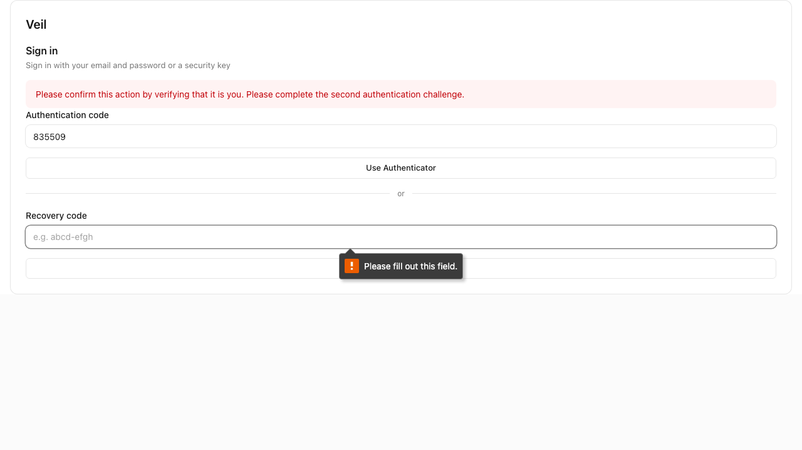

# ✗ search filters the item list

`e2e/tests/vault-web.e2e.ts` · target `web` · failed · 1m 16s

Ran on: browser `chromium 156.0.8078.4` · user agent `Mozilla/5.0 (Macintosh; Intel Mac OS X 10_15_7) AppleWebKit/537.36 (KHTML, like Gecko) HeadlessChrome/156.0.8078.4 Safari/537.36`

**TEST_SETUP_FAILED**

```text
agent.act blocked: devin executor exhausted 8 turns without a verdict
```

Look at: `e2e/tests/vault-web.e2e.ts:14`  

## Steps

1. ✓ `app.open` `/login` (332ms) — `e2e/tests/vault-web.e2e.ts:34`
   - ✗ console error: `Loading the script 'https://static.cloudflareinsights.com/beacon.min.js/vce701823e78c4301a35b7e07294d87301792088814092' violates the following Content Security Policy directive: "script-src 'self'". Note that 'script-src-elem' was not explicitly set, so 'script-src' is used as a fallback. The actio…`
   - ✗ network error: `GET https://static.cloudflareinsights.com/beacon.min.js/vce701823e78c4301a35b7e07294d87301792088814092 csp`
   - ✗ console error: `Loading the script 'https://us-assets.i.posthog.com/static/1.438.8/exception-autocapture.js' violates the following Content Security Policy directive: "script-src 'self'". Note that 'script-src-elem' was not explicitly set, so 'script-src' is used as a fallback. The action has been blocked. (at htt…`
   - ✗ network error: `GET https://us-assets.i.posthog.com/static/1.438.8/exception-autocapture.js csp`
   - ✗ console error: `Loading the script 'https://us-assets.i.posthog.com/array/phc_AjkhQ4ziUxEs9jM6JXJQjya2WkRKuLDWa4QR5XS9zYT8/config.js' violates the following Content Security Policy directive: "script-src 'self'". Note that 'script-src-elem' was not explicitly set, so 'script-src' is used as a fallback. The action …`
   - ✗ network error: `GET https://us-assets.i.posthog.com/array/phc_AjkhQ4ziUxEs9jM6JXJQjya2WkRKuLDWa4QR5XS9zYT8/config.js csp`
   - ✗ console error: `Loading the script 'https://us-assets.i.posthog.com/static/exception-autocapture.js?v=1.438.8' violates the following Content Security Policy directive: "script-src 'self'". Note that 'script-src-elem' was not explicitly set, so 'script-src' is used as a fallback. The action has been blocked. (at h…`
   - ✗ network error: `GET https://us-assets.i.posthog.com/static/exception-autocapture.js?v=1.438.8 csp`
   - ✗ console error: `Connecting to 'https://us-assets.i.posthog.com/array/phc_AjkhQ4ziUxEs9jM6JXJQjya2WkRKuLDWa4QR5XS9zYT8/config' violates the following Content Security Policy directive: "connect-src 'self' https://veil.nyc https://id.veil.nyc https://accounts.veil.nyc https://login.veil.nyc https://us.i.posthog.com"…`
   - ✗ console error: `Fetch API cannot load https://us-assets.i.posthog.com/array/phc_AjkhQ4ziUxEs9jM6JXJQjya2WkRKuLDWa4QR5XS9zYT8/config. Refused to connect because it violates the document's Content Security Policy. (at https://app.veil.nyc/assets/index-Bp02gZL1.js:67)`
   - screen: 1 node at `https://app.veil.nyc/login`
2. ✓ `agent.act` "type `'shlomo@vortex.nyc'` into the ID field" (11.4s) — `e2e/tests/vault-web.e2e.ts:9`
   - cache: no replay: nothing recorded for this step yet; recording not saved: no check passed after this step (`.e2e/cache/047fa4b3b93896023fe36e822ecb3fe4a29de8ff50f875f5d25771798bf49a62.json`)
   - ⚠ network warning: `GET https://accounts.veil.nyc/sessions/whoami 401`
   - ↪ navigated to `https://app.veil.nyc/login?flow=54a1dc6e-a58e-48fc-9605-003ac106020a`
   - ✗ console error: `Loading the script 'https://static.cloudflareinsights.com/beacon.min.js/vce701823e78c4301a35b7e07294d87301792088814092' violates the following Content Security Policy directive: "script-src 'self'". Note that 'script-src-elem' was not explicitly set, so 'script-src' is used as a fallback. The actio…`
   - ✗ network error: `GET https://static.cloudflareinsights.com/beacon.min.js/vce701823e78c4301a35b7e07294d87301792088814092 csp`
   - ✗ console error: `Loading the script 'https://us-assets.i.posthog.com/static/1.438.8/exception-autocapture.js' violates the following Content Security Policy directive: "script-src 'self'". Note that 'script-src-elem' was not explicitly set, so 'script-src' is used as a fallback. The action has been blocked. (at htt…`
   - ✗ network error: `GET https://us-assets.i.posthog.com/static/1.438.8/exception-autocapture.js csp`
   - ✗ console error: `Loading the script 'https://us-assets.i.posthog.com/array/phc_AjkhQ4ziUxEs9jM6JXJQjya2WkRKuLDWa4QR5XS9zYT8/config.js' violates the following Content Security Policy directive: "script-src 'self'". Note that 'script-src-elem' was not explicitly set, so 'script-src' is used as a fallback. The action …`
   - ↪ navigated to `https://app.veil.nyc/login?flow=54a1dc6e-a58e-48fc-9605-003ac106020a`
   - ✗ network error: `GET https://us-assets.i.posthog.com/array/phc_AjkhQ4ziUxEs9jM6JXJQjya2WkRKuLDWa4QR5XS9zYT8/config.js csp`
   - ✗ console error: `Loading the script 'https://us-assets.i.posthog.com/static/exception-autocapture.js?v=1.438.8' violates the following Content Security Policy directive: "script-src 'self'". Note that 'script-src-elem' was not explicitly set, so 'script-src' is used as a fallback. The action has been blocked. (at h…`
   - ✗ network error: `GET https://us-assets.i.posthog.com/static/exception-autocapture.js?v=1.438.8 csp`
   - ✗ console error: `Connecting to 'https://us-assets.i.posthog.com/array/phc_AjkhQ4ziUxEs9jM6JXJQjya2WkRKuLDWa4QR5XS9zYT8/config' violates the following Content Security Policy directive: "connect-src 'self' https://veil.nyc https://id.veil.nyc https://accounts.veil.nyc https://login.veil.nyc https://us.i.posthog.com"…`
   - ✗ console error: `Fetch API cannot load https://us-assets.i.posthog.com/array/phc_AjkhQ4ziUxEs9jM6JXJQjya2WkRKuLDWa4QR5XS9zYT8/config. Refused to connect because it violates the document's Content Security Policy. (at https://app.veil.nyc/assets/index-Bp02gZL1.js:67)`
   - type `"shlomo@vortex.nyc"` into textbox "ID" (27ms)
   - screen: 11 changes since step 1 at `https://app.veil.nyc/login?flow=54a1dc6e-a58e-48fc-9605-003ac106020a`, 12 nodes
     - `added heading "Veil"`
     - `added heading "Sign in"`
     - `added text="Sign in with your email and password or a security key"`
     - `added text="ID"`
     - `added textbox "ID" value="shlomo@vortex.nyc" purpose=username`
     - `added button "Sign in with hardware key"`
     - `added text="or"`
     - `added text="Password"`
     - `added button "Show"`
     - `added textbox "Password" value=<secure> purpose=password [secure]`
     - `added button "Sign in with password"`
3. ✓ `agent.act` "fill the Password field from secret 'vault-password'" (4.8s) — `e2e/tests/vault-web.e2e.ts:10`
   - cache: no replay: nothing recorded for this step yet; nothing recorded: the step changed nothing a replay could check (`.e2e/cache/b79dce311b67a8de848a0b924bd2a451ece60312cde3f0c2713a021573c82f37.json`)
   - fill secret "vault-password" into textbox "Password" (49ms)
   - screen: unchanged since step 2 at `https://app.veil.nyc/login?flow=54a1dc6e-a58e-48fc-9605-003ac106020a`
4. ✓ `agent.act` "tap the 'Sign in with password' button" (6.8s) — `e2e/tests/vault-web.e2e.ts:13`
   - cache: no replay: nothing recorded for this step yet; recording not saved: no check passed after this step (`.e2e/cache/e8b8872e78a6f89184fe056754476fd2620f377eddc4f4f2f2def3c069037db6.json`)
   - tap button "Sign in with password" (756ms)
   - ↪ navigated to `https://app.veil.nyc/login?flow=b2625d18-709e-41c4-88c2-80ce516ea9b2`
   - ✗ console error: `Loading the script 'https://static.cloudflareinsights.com/beacon.min.js/vce701823e78c4301a35b7e07294d87301792088814092' violates the following Content Security Policy directive: "script-src 'self'". Note that 'script-src-elem' was not explicitly set, so 'script-src' is used as a fallback. The actio…`
   - ✗ network error: `GET https://static.cloudflareinsights.com/beacon.min.js/vce701823e78c4301a35b7e07294d87301792088814092 csp`
   - ✗ console error: `Loading the script 'https://us-assets.i.posthog.com/static/1.438.8/exception-autocapture.js' violates the following Content Security Policy directive: "script-src 'self'". Note that 'script-src-elem' was not explicitly set, so 'script-src' is used as a fallback. The action has been blocked. (at htt…`
   - ✗ network error: `GET https://us-assets.i.posthog.com/static/1.438.8/exception-autocapture.js csp`
   - ✗ console error: `Loading the script 'https://us-assets.i.posthog.com/array/phc_AjkhQ4ziUxEs9jM6JXJQjya2WkRKuLDWa4QR5XS9zYT8/config.js' violates the following Content Security Policy directive: "script-src 'self'". Note that 'script-src-elem' was not explicitly set, so 'script-src' is used as a fallback. The action …`
   - ↪ navigated to `https://app.veil.nyc/login?flow=b2625d18-709e-41c4-88c2-80ce516ea9b2`
   - ✗ network error: `GET https://us-assets.i.posthog.com/array/phc_AjkhQ4ziUxEs9jM6JXJQjya2WkRKuLDWa4QR5XS9zYT8/config.js csp`
   - ✗ console error: `Loading the script 'https://us-assets.i.posthog.com/static/exception-autocapture.js?v=1.438.8' violates the following Content Security Policy directive: "script-src 'self'". Note that 'script-src-elem' was not explicitly set, so 'script-src' is used as a fallback. The action has been blocked. (at h…`
   - ✗ network error: `GET https://us-assets.i.posthog.com/static/exception-autocapture.js?v=1.438.8 csp`
   - ✗ console error: `Connecting to 'https://us-assets.i.posthog.com/array/phc_AjkhQ4ziUxEs9jM6JXJQjya2WkRKuLDWa4QR5XS9zYT8/config' violates the following Content Security Policy directive: "connect-src 'self' https://veil.nyc https://id.veil.nyc https://accounts.veil.nyc https://login.veil.nyc https://us.i.posthog.com"…`
   - ✗ console error: `Fetch API cannot load https://us-assets.i.posthog.com/array/phc_AjkhQ4ziUxEs9jM6JXJQjya2WkRKuLDWa4QR5XS9zYT8/config. Refused to connect because it violates the document's Content Security Policy. (at https://app.veil.nyc/assets/index-Bp02gZL1.js:67)`
   - screen: 14 changes since step 3 at `https://app.veil.nyc/login?flow=b2625d18-709e-41c4-88c2-80ce516ea9b2`, 12 nodes
     - `added text="Please confirm this action by verifying that it is you. Please complete the second authentication challenge."`
     - `added text="Authentication code"`
     - `added textbox "Authentication code" purpose=one-time-code`
     - `added button "Use Authenticator"`
     - `added text="Recovery code"`
     - `added textbox "Recovery code"`
     - `added button "Use backup recovery code"`
     - `removed text="ID"`
     - `removed textbox "ID" value="shlomo@vortex.nyc" purpose=username`
     - `removed button "Sign in with hardware key"`
     - `removed text="Password"`
     - `removed button "Show"`
     - 2 more
5. ✗ `agent.act` "enter the 6-digit authenticator code from secret 'totp-code' into the Authentication code field and tap Continue" (53.0s) — **TEST_SETUP_FAILED** — `e2e/tests/vault-web.e2e.ts:14`
   > devin executor exhausted 8 turns without a verdict
   - cache: no replay: nothing recorded for this step yet (`.e2e/cache/59e89779553cf10a2d334277b0089400fa3d3d04c5a2087c2d7fc0f10249af0a.json`)
   - fill secret "totp-code" into textbox "Authentication code" (36ms)
   - tap button "Use Authenticator" (28ms)
   - tap button "Use Authenticator" (39ms)
   - tap button "Use Authenticator" (38ms)
   - tap button "Use Authenticator" (39ms)
   - tap button "Use Authenticator" (38ms)
   - tap button "Use Authenticator" (34ms)
   - tap button "Use Authenticator" (33ms)
   - screen: 1 change since step 4 at `https://app.veil.nyc/login?flow=b2625d18-709e-41c4-88c2-80ce516ea9b2`, 12 nodes
     - `changed textbox "Authentication code" value="<secret:totp-code>" purpose=one-time-code (was: textbox "Authentication code" purpose=one-time-code)`

## App log

What the app logged, oldest first, with the step it happened in.

- step 1 · ✗ console error: `Loading the script 'https://static.cloudflareinsights.com/beacon.min.js/vce701823e78c4301a35b7e07294d87301792088814092' violates the following Content Security Policy directive: "script-src 'self'". Note that 'script-src-elem' was not explicitly set, so 'script-src' is used as a fallback. The actio…`
- step 1 · ✗ network error: `GET https://static.cloudflareinsights.com/beacon.min.js/vce701823e78c4301a35b7e07294d87301792088814092 csp`
- step 1 · ✗ console error: `Loading the script 'https://us-assets.i.posthog.com/static/1.438.8/exception-autocapture.js' violates the following Content Security Policy directive: "script-src 'self'". Note that 'script-src-elem' was not explicitly set, so 'script-src' is used as a fallback. The action has been blocked. (at htt…`
- step 1 · ✗ network error: `GET https://us-assets.i.posthog.com/static/1.438.8/exception-autocapture.js csp`
- step 1 · ✗ console error: `Loading the script 'https://us-assets.i.posthog.com/array/phc_AjkhQ4ziUxEs9jM6JXJQjya2WkRKuLDWa4QR5XS9zYT8/config.js' violates the following Content Security Policy directive: "script-src 'self'". Note that 'script-src-elem' was not explicitly set, so 'script-src' is used as a fallback. The action …`
- step 1 · ✗ network error: `GET https://us-assets.i.posthog.com/array/phc_AjkhQ4ziUxEs9jM6JXJQjya2WkRKuLDWa4QR5XS9zYT8/config.js csp`
- step 1 · ✗ console error: `Loading the script 'https://us-assets.i.posthog.com/static/exception-autocapture.js?v=1.438.8' violates the following Content Security Policy directive: "script-src 'self'". Note that 'script-src-elem' was not explicitly set, so 'script-src' is used as a fallback. The action has been blocked. (at h…`
- step 1 · ✗ network error: `GET https://us-assets.i.posthog.com/static/exception-autocapture.js?v=1.438.8 csp`
- step 1 · ✗ console error: `Connecting to 'https://us-assets.i.posthog.com/array/phc_AjkhQ4ziUxEs9jM6JXJQjya2WkRKuLDWa4QR5XS9zYT8/config' violates the following Content Security Policy directive: "connect-src 'self' https://veil.nyc https://id.veil.nyc https://accounts.veil.nyc https://login.veil.nyc https://us.i.posthog.com"…`
- step 1 · ✗ console error: `Fetch API cannot load https://us-assets.i.posthog.com/array/phc_AjkhQ4ziUxEs9jM6JXJQjya2WkRKuLDWa4QR5XS9zYT8/config. Refused to connect because it violates the document's Content Security Policy. (at https://app.veil.nyc/assets/index-Bp02gZL1.js:67)`
- step 2 · ⚠ network warning: `GET https://accounts.veil.nyc/sessions/whoami 401`
- step 2 · ✗ console error: `Loading the script 'https://static.cloudflareinsights.com/beacon.min.js/vce701823e78c4301a35b7e07294d87301792088814092' violates the following Content Security Policy directive: "script-src 'self'". Note that 'script-src-elem' was not explicitly set, so 'script-src' is used as a fallback. The actio…`
- step 2 · ✗ network error: `GET https://static.cloudflareinsights.com/beacon.min.js/vce701823e78c4301a35b7e07294d87301792088814092 csp`
- step 2 · ✗ console error: `Loading the script 'https://us-assets.i.posthog.com/static/1.438.8/exception-autocapture.js' violates the following Content Security Policy directive: "script-src 'self'". Note that 'script-src-elem' was not explicitly set, so 'script-src' is used as a fallback. The action has been blocked. (at htt…`
- step 2 · ✗ network error: `GET https://us-assets.i.posthog.com/static/1.438.8/exception-autocapture.js csp`
- step 2 · ✗ console error: `Loading the script 'https://us-assets.i.posthog.com/array/phc_AjkhQ4ziUxEs9jM6JXJQjya2WkRKuLDWa4QR5XS9zYT8/config.js' violates the following Content Security Policy directive: "script-src 'self'". Note that 'script-src-elem' was not explicitly set, so 'script-src' is used as a fallback. The action …`
- step 2 · ✗ network error: `GET https://us-assets.i.posthog.com/array/phc_AjkhQ4ziUxEs9jM6JXJQjya2WkRKuLDWa4QR5XS9zYT8/config.js csp`
- step 2 · ✗ console error: `Loading the script 'https://us-assets.i.posthog.com/static/exception-autocapture.js?v=1.438.8' violates the following Content Security Policy directive: "script-src 'self'". Note that 'script-src-elem' was not explicitly set, so 'script-src' is used as a fallback. The action has been blocked. (at h…`
- step 2 · ✗ network error: `GET https://us-assets.i.posthog.com/static/exception-autocapture.js?v=1.438.8 csp`
- step 2 · ✗ console error: `Connecting to 'https://us-assets.i.posthog.com/array/phc_AjkhQ4ziUxEs9jM6JXJQjya2WkRKuLDWa4QR5XS9zYT8/config' violates the following Content Security Policy directive: "connect-src 'self' https://veil.nyc https://id.veil.nyc https://accounts.veil.nyc https://login.veil.nyc https://us.i.posthog.com"…`
- step 2 · ✗ console error: `Fetch API cannot load https://us-assets.i.posthog.com/array/phc_AjkhQ4ziUxEs9jM6JXJQjya2WkRKuLDWa4QR5XS9zYT8/config. Refused to connect because it violates the document's Content Security Policy. (at https://app.veil.nyc/assets/index-Bp02gZL1.js:67)`
- step 4 · ✗ console error: `Loading the script 'https://static.cloudflareinsights.com/beacon.min.js/vce701823e78c4301a35b7e07294d87301792088814092' violates the following Content Security Policy directive: "script-src 'self'". Note that 'script-src-elem' was not explicitly set, so 'script-src' is used as a fallback. The actio…`
- step 4 · ✗ network error: `GET https://static.cloudflareinsights.com/beacon.min.js/vce701823e78c4301a35b7e07294d87301792088814092 csp`
- step 4 · ✗ console error: `Loading the script 'https://us-assets.i.posthog.com/static/1.438.8/exception-autocapture.js' violates the following Content Security Policy directive: "script-src 'self'". Note that 'script-src-elem' was not explicitly set, so 'script-src' is used as a fallback. The action has been blocked. (at htt…`
- step 4 · ✗ network error: `GET https://us-assets.i.posthog.com/static/1.438.8/exception-autocapture.js csp`
- step 4 · ✗ console error: `Loading the script 'https://us-assets.i.posthog.com/array/phc_AjkhQ4ziUxEs9jM6JXJQjya2WkRKuLDWa4QR5XS9zYT8/config.js' violates the following Content Security Policy directive: "script-src 'self'". Note that 'script-src-elem' was not explicitly set, so 'script-src' is used as a fallback. The action …`
- step 4 · ✗ network error: `GET https://us-assets.i.posthog.com/array/phc_AjkhQ4ziUxEs9jM6JXJQjya2WkRKuLDWa4QR5XS9zYT8/config.js csp`
- step 4 · ✗ console error: `Loading the script 'https://us-assets.i.posthog.com/static/exception-autocapture.js?v=1.438.8' violates the following Content Security Policy directive: "script-src 'self'". Note that 'script-src-elem' was not explicitly set, so 'script-src' is used as a fallback. The action has been blocked. (at h…`
- step 4 · ✗ network error: `GET https://us-assets.i.posthog.com/static/exception-autocapture.js?v=1.438.8 csp`
- step 4 · ✗ console error: `Connecting to 'https://us-assets.i.posthog.com/array/phc_AjkhQ4ziUxEs9jM6JXJQjya2WkRKuLDWa4QR5XS9zYT8/config' violates the following Content Security Policy directive: "connect-src 'self' https://veil.nyc https://id.veil.nyc https://accounts.veil.nyc https://login.veil.nyc https://us.i.posthog.com"…`
- step 4 · ✗ console error: `Fetch API cannot load https://us-assets.i.posthog.com/array/phc_AjkhQ4ziUxEs9jM6JXJQjya2WkRKuLDWa4QR5XS9zYT8/config. Refused to connect because it violates the document's Content Security Policy. (at https://app.veil.nyc/assets/index-Bp02gZL1.js:67)`

## Screen at failure

`https://app.veil.nyc/login?flow=b2625d18-709e-41c4-88c2-80ce516ea9b2` · viewport 1280x720 · 12 nodes  



The screen as the agent reads it, one node per line: `#id role "name" text="…" [states]`.

```text
#root document "Veil"
 #n66001 heading "Veil"
 #n66002 heading "Sign in"
 #n66003 text="Sign in with your email and password or a security key"
 #n66004 text="Please confirm this action by verifying that it is you. Please complete the second authentication challenge."
 #n66005 text="Authentication code"
 #n66006 textbox "Authentication code" value="<secret:totp-code>" purpose=one-time-code
 #n66007 button "Use Authenticator"
 #n66008 text="or"
 #n66009 text="Recovery code"
 #n66010 textbox "Recovery code" [focused]
 #n66011 button "Use backup recovery code"
```

## Evidence

- [screenshot](attempt-1/screenshots/001-failure.png) `.e2e/results/vault-web-search-filters-the-item-list-017bf178a3b1544f/attempt-1/screenshots/001-failure.png`
- [screen](attempt-1/screen-at-failure.txt) `.e2e/results/vault-web-search-filters-the-item-list-017bf178a3b1544f/attempt-1/screen-at-failure.txt`

<sub>e2e 0.21.3 · run `01a184d8-ea1d-7d4a-8f40-7382754ec4e8` · the whole run is in `report.json`</sub>
