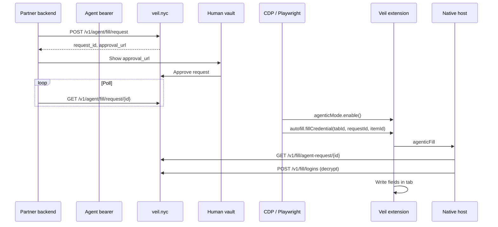

# Agentic autofill for browser automation

Veil’s partner surface for **Browserbase-class** integrations: load the Veil extension in the agent’s Chromium session, file a login ask with the **agent** bearer, human approves in the vault, then drive **`fillCredential` over CDP** — credentials never enter the LLM or your backend logs.

Same invariant as [1Password Secure Agentic Autofill](https://www.1password.dev/agentic-autofill/partners/fill) and the [Browserbase guide](https://docs.browserbase.com/integrations/1password/agentic-autofill). Veil uses org agents + `app.veil.nyc/requests` instead of 1Password OAuth and the desktop app link.

## Prerequisites

| Piece | Purpose |
|--------|---------|
| **Veil origin** | `https://veil.nyc` (or your deploy) |
| **Agent** | Hydra client with grants on the login item (`veil agent add`, `veil grant add`) |
| **Human** | Signed in on the fill host (`veil human login --out-file`, `veil fill install`) |
| **Chromium with extensions** | Chrome for Testing, Chromium, or a cloud browser that loads unpacked MV3 — branded Chrome ignores `--load-extension` |
| **Native host** | `veil fill` bridge running (installed by `veil fill install`) |

API lane (no browser): MCP / `POST /v1/use` — not this doc.

## Load the extension

Pack or unpack `apps/fill` (or `~/.veil/extension` after `veil fill install`). Pin the manifest **`key`** so the extension ID is stable across loads.

```bash
# Local agent-browser / Playwright (Chrome for Testing)
EXT="$HOME/.veil/extension"   # or repo apps/fill
PROFILE="$HOME/.veil/agent-browser-profile"
chrome \
  --user-data-dir="$PROFILE" \
  --disable-extensions-except="$EXT" \
  --load-extension="$EXT" \
  --remote-debugging-port=9222 \
  about:blank
```

Extension ID (from `apps/fill/manifest.json` public key): **`oboonakemofpalcgghocfoadofidjkkk`**.

Service worker URL for CDP:

```text
chrome-extension://oboonakemofpalcgghocfoadofidjkkk/background.js
```

Cloud providers: upload the extension once at session create (same pattern as Browserbase’s 1Password ZIP upload).

## Allow network access

If the browser uses an outbound allowlist, permit at least:

| Host | Why |
|------|-----|
| `veil.nyc` | Origin — items, agent fill API, fill decrypt |
| `login.veil.nyc` | Human remint when host returns `need_login` |
| `app.veil.nyc` | Approval UI (human opens in a normal browser) |

## Partner flow (matches Browserbase `signIn`)



### 1. File the access request (backend, agent JWT)

```http
POST /v1/agent/fill/request
Authorization: Bearer <agent-token>
Content-Type: application/json

{"item_id":"github","url":"https://github.com/login"}
```

```json
{
  "request_id": "req_…",
  "status": "open",
  "item_id": "github",
  "expires_at": "…",
  "approval_url": "https://app.veil.nyc/requests"
}
```

Same row as MCP **`request_fill`**. MCP-only agents can skip this HTTP and use `request_id` from the tool result.

### 2. Human approval

Send the human to **`approval_url`** (or push via vault notifications). They approve the fill ask like any other agent request.

### 3. Poll until approved (backend, agent JWT)

```http
GET /v1/agent/fill/request/{request_id}
Authorization: Bearer <agent-token>
```

Stop on `approved`, `denied`, or `expired`. Do not log response bodies in agent-visible logs.

### 4. Call the extension over CDP

Attach to the **service worker** target (not the page). API lives on **`globalThis.veilAgentic.v1`** (Veil namespaced parallel to 1Password’s `globalThis.api`).

Wait for readiness:

```javascript
await worker.evaluate(async () => {
  const s = await veilAgentic.v1.initialization.whenSettled();
  if (s !== "ready") throw new Error(s);
});
```

Enable agentic mode for the tab (required before fill):

```javascript
await worker.evaluate(async (tabId) => {
  return veilAgentic.v1.agenticMode.enable({ tabId });
}, tabId);
```

Optional status check from the extension (uses human JWT on the host, not agent bearer):

```javascript
await worker.evaluate(async (requestId) => {
  return veilAgentic.v1.autofill.checkRequestStatus({ requestId });
}, requestId);
```

Fill after approval:

```javascript
await worker.evaluate(
  async (args) => {
    return veilAgentic.v1.autofill.fillCredential(args);
  },
  { tabId, requestId, itemId, submit: true },
);
```

| Argument | Purpose |
|----------|---------|
| `tabId` | Chrome `chrome.tabs` id for the login page |
| `requestId` | From step 1 |
| `itemId` | Granted item id (must match approved row) |
| `submit` | Optional — click first submit control (1Password-shaped; verify `successUrl` yourself) |

Resolve `tabId` inside the worker:

```javascript
const [tab] = await chrome.tabs.query({ active: true, currentWindow: true });
```

### 5. Verify success

Navigate or assert the post-login URL yourself (`successUrl` pattern in Browserbase docs). Veil does not return credential values to your code — only `{ filled: true }` or an error code.

## Error codes (`fillCredential`)

| Code | Meaning |
|------|---------|
| `agenticModeNotEnabled` | Call `agenticMode.enable` first |
| `need_login` | Host human JWT dead — remint with `veil human login` |
| `denied` | Request not approved, URL/item mismatch, or fill blocked |
| `invalidArgument` | Bad tab, URL, or ids |
| `fillFailed` | Decrypt ok but DOM write failed |

## agent-browser / `vb`

Use a **persistent profile** with the extension pre-loaded (see above). Your coding agent should:

1. MCP **`request_fill`** *or* your backend **`POST /v1/agent/fill/request`**
2. Human approves
3. MCP **`approval_status`** *or* backend poll
4. Your automation driver calls **`veilAgentic.v1.autofill.fillCredential`** on the same browser that loaded the extension

Default isolated `vb` sessions without the extension will never fill — that is expected.

## Example

See [`examples/agentic-autofill/signin.mjs`](../../examples/agentic-autofill/signin.mjs) for a minimal Playwright + CDP sketch (env: `VEIL_AGENT_TOKEN`, extension path, login URLs).

## Related

- [`docs/fill.md`](../fill.md) — execute vs choose, Touch ID, session write
- [`docs/veil-for-agents.md`](../veil-for-agents.md) — MCP tools and website playbook
- [`docs/1password-for-agents-landscape.md`](../1password-for-agents-landscape.md) — competitive map
